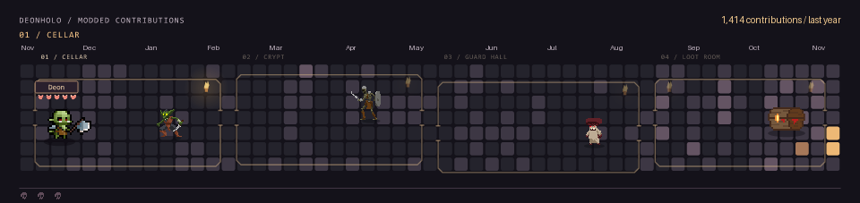

# hey, i'm deon.

i like modding stuff. games, software, whatever makes me think “this would be better if it just did this.”

lately i'm building with coding agents and Spec-Driven Development. i figure out how something should work, turn that into a spec, then build, test, and keep tweaking it.

## one more room.

<picture>
  <source media="(prefers-reduced-motion: reduce)" srcset="assets/dungeon-still.png">
  
</picture>

i turned my contribution grid into a dungeon. three runs, one very hungry chest. the grid refreshes daily from github.

pixel art · [Zerie pack 01](https://zerie.itch.io/tiny-rpg-character-asset-pack) + [pack 02](https://zerie.itch.io/tiny-rpg-character-asset-pack-02) · [LuizMelo](https://luizmelo.itch.io/monsters-creatures-fantasy) · [rvros](https://rvros.itch.io/pixel-art-animated-slime) · [joraxus](https://inspired-goblin.itch.io/chest-mimic)

## what i work on

- **agentic coding** — specs, smaller tasks, coding agents, reviews, and testing.
- **game + software mods** — changing mechanics and getting existing things to behave differently.
- **browser userscripts** — extra context, fewer clicks, less tab hopping.
- **automation** — PowerShell tools for the repetitive Windows stuff.
- **web apps + AI integrations** — dashboards, PWAs, and MCP tools that do something useful.

## some stuff i've built

| project | what it does |
| --- | --- |
| [WildTrack](https://github.com/DeonHolo/WildTrack) | capstone submissions, adviser and AI reviews, and final PDF archives in one workspace. |
| [DnDGPT](https://github.com/DeonHolo/DnDGPT) | ChatGPT as your GM, with a saved campaign dashboard and rules for D&D and my homebrew games. |
| [qBitLauncher](https://github.com/DeonHolo/qBitLauncher) | handles the post-download routine: extracting archives, finding executables, and cleaning up. |
| [1337x Steam hover previews](https://github.com/DeonHolo/1337xSteamHoverPreview) / [CS.RIN.RU version](https://github.com/DeonHolo/cs-rin-ru-SteamHoverPreview) | Steam game info without opening another tab. Featured on [FMHY.net!](https://fmhy.net/gaming-tools#:~:text=1337x%20Store%20Hover%20%2D%20Add%20Steam%20Store%20Hover%20Details%20to%201337x) |
| [Pacifist's Vow](https://github.com/DeonHolo/Pacifists-Vow) | a BG3 non-lethal overhaul for melee, ranged attacks, and spells. |
| [WildMaps](https://github.com/DeonHolo/WildMaps) | a campus exploration PWA with landmark recognition and collectible badges. |

also: [DataForge](https://github.com/DeonHolo/DataForge) for preparing image datasets, and [DeskPurge](https://github.com/DeonHolo/DeskPurge) for reclaiming disk space.

WildMaps also earned **1st runner-up** and **Best Product** at CIT-U's ABM & GAS Days Pitch Conference 2026.

## things i reach for

`TypeScript / JavaScript` · `React` · `Java / Spring Boot` · `Python` · `PowerShell` · `Lua`

---

[my userscripts](https://greasyfork.org/en/users/1340389-deon-holo) · [linkedin](https://www.linkedin.com/in/ron-taghoy/) · [all my repos](https://github.com/DeonHolo?tab=repositories)

there is probably a mod for that.
